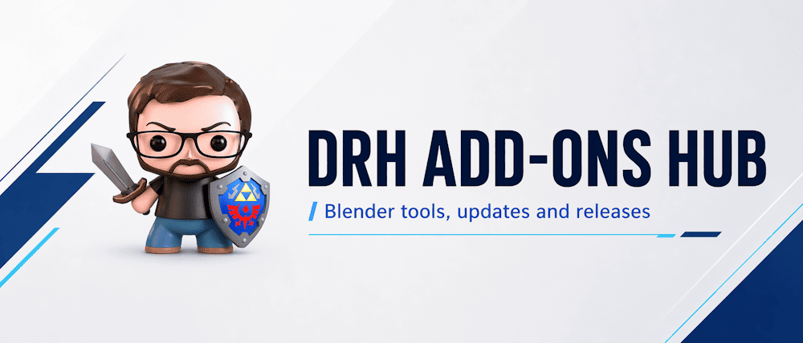



# DRH Add-ons Hub

**Six Blender add-ons, one place to read the docs. Shaders and materials first, because that's what most people come for.**

## Where to start

Downloads live on BlendKit. GitHub holds the manuals, changelogs, and the issue tracker for each add-on.

If you came for shaders and materials, start at the [BlendKit profile](https://www.blendkit.com/?query=author_id:205846). Then come back for Scene Material Inventory, which tells you what your scene already contains, and Color Ramp Studio, which is where most shader work turns into clicking.

## Which add-on do you need

**You keep building color ramps by hand.** Color Ramp Studio.
**You're about to send a .blend and can't list its materials, images, or missing paths.** Scene Material Inventory.
**Things land in the wrong place after modifiers.** Object Layout Studio Complete.
**You just need align, space, rotate, match transforms.** Object Layout Studio Lite.
**The client gives you feet, Blender gives you meters.** Dual Units & Measurements.
**You have 40 add-ons and something broke.** Add-on Manager & Audit.

## The six

| Add-on | Version | What it does | Get it |
|---|---|---|---|
| **Color Ramp Studio** | 1.1.0 | Build, sample, convert, and repair ramps. Preset library with color-family filtering, image and screen sampling, sRGB-aware edits, and a route back to native nodes. | [Download](https://www.blendkit.com/asset-gallery-detail/62ac725e-c55e-4e26-9e39-f6b81432d962/) · [Docs](https://github.com/pacosalasv/DRH_Color_Ramp_Studio-Support) |
| **Scene Material Inventory** | 1.0.0 | Materials, shader nodes, images, PBR maps, and per-collection usage, exported as searchable HTML, XLSX, or CSV. Path sanitization is on by default. | [Download](https://www.blendkit.com/asset-gallery-detail/8225a754-32cd-482d-a0d3-84ea3850fc8f/) · [Docs](https://github.com/pacosalasv/DRH_Scene_Material_Inventory-Support) |
| **Object Layout Studio Complete** | 1.0.0 | Align and distribute against origin, evaluated bounds, active object, selection, 3D cursor, or world. Ground, register, quantize, and transform as one pass. | [Download](https://www.blendkit.com/asset-gallery-detail/63177030-cdb4-45ae-8bec-76a3ee48d151/) · [Docs](https://github.com/pacosalasv/DRH_Object_Layout_Studio-Support) |
| **Object Layout Studio Lite** | 1.0.0 | Align, space, rotate, match transforms. The lean version of the same panel. | [Download](https://www.blendkit.com/asset-gallery-detail/0b1494ca-c801-4cbf-9783-46ddbcf0090f/) · [Docs](https://github.com/pacosalasv/DRH_Object_Layout_Studio-Support) |
| **Dual Units & Measurements** | 1.1.0 | Scene units and an alternate unit side by side in an N panel, with presets for metric, imperial, product, architecture, site, carpentry, and 3D printing. Precision to six decimals, optional split units. | [Download](https://www.blendkit.com/asset-gallery-detail/6fdca217-16ce-4771-bd1f-3aba38f48858/) · [Docs](https://github.com/pacosalasv/DRH_Dual_Units-Support) |
| **Add-on Manager & Audit** | 1.0.0 | Scans your local inventory, flags duplicates, version conflicts, shadow states, and hotkey candidates, compares two snapshots, and exports the report. | [Download](https://www.blendkit.com/asset-gallery-detail/89fe5b10-df59-4940-b66e-8e8114e9fd53/) · [Docs](https://github.com/pacosalasv/DRH_Addons_Audit-Support) |

All six are free. Blender 4.2 or newer on Windows, macOS, or Linux.

Catalog page with all six: [Blender add-ons by Paco Salas on BlendKit](https://www.blendkit.com/?query=category_subtree:addon+author_id:205846). Materials, shaders, HDRIs and models live on the same profile: [asset library](https://www.blendkit.com/?query=author_id:205846).

## Paused, not dead

Built and parked while the released six get the attention. Status and discussion live here in the Hub, not in separate repos.

| Add-on | Focus | Status | Repo |
|---|---|---|---|
| Asset Pipeline Studio | Multi-format import/export, validation, presets for print, ArchViz, Godot, Unity, Unreal | Built, paused at 1.0.0 | [Docs](https://github.com/pacosalasv/DRH_Asset_Pipeline_Studio-Support) |
| Rock Studio | Procedural rocks with Mesh and Geometry Nodes, scatter | Built, paused at 1.0.0 | [Docs](https://github.com/pacosalasv/DRH_Rock_Studio-Support) |
| Mechanical Component Builder | Bolts, screws, nuts, washers, springs, rivets as parameters | Built, paused at 1.0.0 | [Docs](https://github.com/pacosalasv/DRH_Mechanical_Component_Builder-Support) |
| Dice Studio | Mesh-only polyhedral dice with body, label, and relief controls | Built, paused at 1.0.0 | [Docs](https://github.com/pacosalasv/DRH_Dice_Studio-Support) |
| Clock Studio | Editable clock assets for props and visualization | Built, paused at 1.0.0 | [Docs](https://github.com/pacosalasv/DRH_Clock_Studio-Support) |

## Planned, and open about it

These have a repository and a scope discussion, not a build. An issue naming your use case is what moves them.

| Add-on | Intent | Repo |
|---|---|---|
| Node Toolkit | Node graph cleanup, layout, reroutes, color control | [Docs](https://github.com/pacosalasv/DRH_Node_Toolkit-Support) |
| Material Inventory | Materials across a whole library instead of one open scene | [Docs](https://github.com/pacosalasv/DRH_Material_Inventory-Support) |
| Asset Library Tools | Metadata, findability, catalog hygiene for asset libraries | [Docs](https://github.com/pacosalasv/DRH_Asset_Library_Tools-Support) |
| Smart Cut | Cutting and seaming that follows curvature | [Docs](https://github.com/pacosalasv/DRH_Smart_Cut-Support) |
| Cloud Studio | Skies, volumes, atmospheric depth | [Docs](https://github.com/pacosalasv/DRH_Cloud_Studio-Support) |

## How the pieces fit

Install Scene Material Inventory first. It shows what materials and textures you already own, so you buy or build shaders against reality instead of guessing. Then Color Ramp Studio handles the ramps those materials need. Object Layout Studio and Dual Units cover the modeling side; Add-on Manager keeps the stack from turning on you.

## Help

Open an issue in the repo for the add-on you're using, not in this Hub, unless the question spans several. Screenshots of the panel and the Blender version save a round trip.

Learn more or browse shaders and materials: [BlendKit profile](https://www.blendkit.com/?query=author_id:205846) · [Paco's GitHub](https://github.com/pacosalasv) · [Xtreme Mindset lab](https://xtrememindset.blogspot.com/)

  
   
  <strong>PayPal?</strong> <a href="https://www.paypal.com/paypalme/pacosalas?locale.x=en_US&country.x=MX">Support via PayPal</a>

